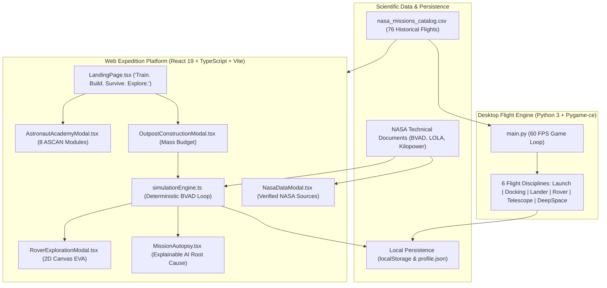

# 🚀 Jr_AstroCamp: Beyond Earth
### *“Train. Build. Survive. Explore.”*

**NASA International Space Apps Challenge 2026**  
**Official Challenge:** [Build a Junior Astronaut Mission Trainer](https://www.spaceappschallenge.org/2026/challenges/build-a-junior-astronaut-mission-trainer/)  
**Team Mysterio**

[](https://react.dev)
[](https://www.pygame.org)
[](https://vitejs.dev)
[](./docs/TESTING.md)
[](./docs/SCIENCE_AND_DATA_SOURCES.md)
[](#-for-competition-judges-1-click-instant-demo-mode)

## GitHub Pages Deployment

The `.github/workflows/deploy-pages.yml` workflow builds the app on pushes to `main` and deploys `dist`. A repository admin must set **Settings → Pages → Build and deployment → Source** to **GitHub Actions** before the workflow can publish. The Vite base path is configured for this repository's Pages URL.

---

## 🏆 For Competition Judges: 1-Click Instant Demo Mode

Judges have limited evaluation time! We built a dedicated **Judge Bypass & Instant Demo Gateway** accessible right on the Landing Page and Top Navigation (`🏆 Space Apps Judge Preview`):

- **✨ 1-Click Complete Unlock:** Instantly unlocks **999,999 Cadet Credits**, all **76 Historical NASA Missions**, and all **8 ASCAN Academy Badges** without grinding.
- **🛰️ Interactive 3D Equipment Depot:** Inspect high-fidelity NASA 3D hardware (ACES Suit, Apollo Lunar Module, Artemis Gateway Core, Deep Space Communications Dish).
- **📡 Live NASA Telemetry Pipeline:** Toggle real-time scientific data feeds, mathematical formulas, and official dataset citations (NASA BVAD-2015, LOLA GDR, Kilopower KRUSTY).
- **📜 NASA Flight Certificate Generator:** Produce authentic, printable Vector/Canvas astronaut graduation certificates complete with cadet callsign, fuel efficiency, gold astronaut wings, and NASA challenge verification stamp.
- **👩‍🏫 Dual-Role Authentication:** Real student cadet accounts and verified teacher accounts (`@school.edu`) with a live Junior Astronaut Classroom Roster.

---

## 🌟 1. Executive Summary & Problem Statement

> *"In a universe where the next generation of astronauts is sitting in classrooms right now, Jr_AstroCamp is our answer to the question every space agency asks: How do you turn a curious kid into a mission-ready thinker?"*

Most educational space software either reduces authentic space science to decorative cartoons with no genuine stakes, or buries young minds in dry, non-interactive encyclopedias.

**Jr_AstroCamp: Beyond Earth** transforms learning into a high-stakes, authentic aerospace expedition. Grounded in real NASA engineering data from the **Artemis program**, **Lunar Reconnaissance Orbiter (LRO)**, and **Mars Science Laboratory (MSL)**, cadets don't simply read about space—they **train**, **budget limited rocket cargo**, **command human life support systems**, **dodge lunar night power crises**, **drive scientific rovers**, and **experience the real chain-reaction consequences of every engineering trade-off.**

The project features a **unified dual-engine architecture**:
1. **Interactive Web Expedition Simulator (React 19 + TypeScript + Three.js + HTML5 Canvas):** A full turn-based planetary base builder, cargo allocator, rover simulation, and 8-lesson Astronaut Academy.
2. **Desktop 60 FPS Flight Simulator (Python 3 + Pygame-ce):** A high-performance flight physics engine with 76 cataloged historical NASA missions across 6 flight disciplines (Launch, Docking, Lunar Landing, Rover Traverse, Space Telescope, Deep Space Slingshot).

---

## 👥 2. Team Mysterio

| Role | Responsibility |
| :--- | :--- |
| 🤖 AI Automation Engineer | Data ingestion pipelines & automated catalog content delivery |
| 📊 Data Scientist | 76 NASA mission datasets, realistic telemetry & trajectory physics |
| 🧠 ML Engineer | Explainable AI debriefs & root-cause failure analysis |
| 💻 Full-Stack Developer | Pygame desktop simulator & React/TypeScript companion web portal |
| 🔭 Researcher | Historical NASA flight accuracy, telemetry grounding & STEM alignment |
| 🎨 UI/UX Designer | Immersive space aesthetic, HUD interfaces, comic storyboards & sound design |

---

## 🎯 3. The Core Philosophy: "Four Doors Into Every Concept"

Traditional STEM content either oversimplifies real engineering into cartoons or drowns young learners in dense technical jargon. Worse, single-format tools leave diverse classrooms behind.

Jr_AstroCamp solves this with **Four Doors**:

1. 🎮 **Play & Simulate**: Real 60 FPS flight physics across 6 mission disciplines.
2. 📖 **Visual Story Comics**: Dynamic panels narrating real crew triumphs and historical challenges.
3. 📢 **Audio Lessons**: CapCom radio briefings and synthesized audio logs for listening anywhere.
4. 📓 **Handwritten Notebooks**: Digital mission journals for students who learn through writing and hypothesis logging.

---

## 🎮 4. Complete Feature Tour

### 🎓 1. Astronaut Academy (8 Interactive ASCAN Modules)
A guided, interactive astronaut training sequence aligned with NASA human exploration protocols:
- **Module 1: Airlock & Depressurization Safety:** Atmospheric pressure differentials ($\Delta P$) and 100% O2 pre-breathe to prevent decompression sickness.
- **Module 2: ECLSS & Sabatier Reactions:** Carbon dioxide scrubbing and chemical catalytic reaction: $\text{CO}_2 + 4\text{H}_2 \rightarrow \text{CH}_4 + 2\text{H}_2\text{O}$.
- **Module 3: Power: Photovoltaics vs Fission:** Sun-tracking solar mast angles vs continuous 24/7 Kilopower nuclear Stirling generation during the 354-hour lunar night.
- **Module 4: Potable Water Recycling:** Vacuum distillation vs thermoelectric membrane loops recovering up to 98% of human moisture.
- **Module 5: Hydroponic Biomass & Nutrition:** Dual-spectrum 450nm/660nm LED salad pods, plant transpiration, and psychological crew benefits.
- **Module 6: Space Radiation & Regolith Shielding:** Galactic Cosmic Rays (GCR), Solar Particle Events (SPE), ALARA guidelines, and 1.5m sintered regolith storm vaults.
- **Module 7: Rover Traction & Terramechanics:** Regolith wheel-slip ratio, steering geometry, slope limits, and radar navigation.
- **Module 8: Cryogenic Core Sample Collection:** Raman spectroscopy and identifying sub-surface water ice in permanently shadowed polar craters (<40 K).

### 🚀 2. Mission Selection
- **Lunar Expedition (Shackleton Polar Base):** 30-Sol primary mission at the lunar South Pole. Features the extreme 354-hour lunar night and cryogenic cold traps.
- **Martian Outpost (Jezero Crater):** 40-Sol deep-space mission featuring atmospheric dust storm opacity ($\tau$), thin 610 Pa atmosphere, and longer telemetry communication delays.

### 🏗️ 3. Outpost Construction & Cargo Budget
Cadets are allocated a strict launch mass limit on the heavy-lift booster:
- **Lunar Mass Budget:** `45,000 kg` | **Mars Mass Budget:** `60,000 kg`
- Choose across 10 critical systems: Habitat, Power Generation, Energy Storage, Life Support, Water Recycling, Greenhouse, Radiation Shielding, Communications, Maintenance, and Surface Rover.
- **Real Trade-Offs:** Selecting heavy high-tech gear (e.g. Kilopower Reactor + Heavy Dome + Sabatier + Full Biome) exceeds the 45,000 kg rocket limit and **locks the launch button**, forcing cadets to balance mass vs capability.

### 🕹️ 4. Mission Control: Core Turn-Based Simulation
- **Authoritative Deterministic Physics:** Based on the NASA BVAD human metabolic baseline ($0.84\text{ kg O}_2$, $2.50\text{ kg H}_2\text{O}$ per crew-day).
- **Diurnal Day/Night Cycle:** Solar arrays generate 0 kW during the 354-hour lunar night (Sols 16–27). If batteries deplete to 0%, habitat heaters freeze, triggering critical failure.
- **Shift Directives:** *Standard Operations*, *Power Conservation* (cuts base electrical load by 40%), *Science Intensive* (+10 science yield at high power cost), *ECLSS Overhaul*, *Greenhouse Surge*, and *Rover EVA*.

### 📰 5. Mission Events & Branching Decisions
- Realistic, unscripted operational events: *Coronal Mass Ejections (CME)*, *Regolith Dust Abrasions*, *Water Recovery Membrane Leaks*, *Hydroponic Root Blight*, and *Cryogenic Ice Discoveries*.
- Comic storyboard panels illustrate the situation with multi-character dialogue (Cadet Maya, Commander Dadu, Houston CapCom).
- Each response option has explicit mathematical consequences on life-support reserves.

### 🚙 6. Playable Surface Rover Exploration (EVA Minigame)
- Top-down 2D canvas physics simulation with keyboard (`WASD`/Arrows) and mobile on-screen controls.
- Dynamic wheel tracks, crater terrain hazards, high-relief boulders, battery consumption, and a real-time radar waypoint compass pointing toward volatile ice hotspots.
- Drill core samples to collect Science Research Points and return safely to base before battery exhaustion.

### 🔬 7. Science Learning Hub & NASA Datasets
- 6 comprehensive domains documenting real NASA baseline datasets (BVAD, LOLA, Kilopower, CRaTER, REMS, NSSDC).
- Explicit `[REAL NASA DATA]` vs `[GAME SIMULATION VALUE]` labeling for complete scientific transparency.

### 📊 8. Mission Autopsy & Debrief
- Evaluates mission outcome (`VICTORY`, `PARTIAL_SUCCESS`, or `CRITICAL_FAILURE`).
- **Explainable AI Root-Cause Tree:** Details the exact cascading chain of events that led to mission success or failure.
- Actionable NASA engineering recommendations for the cadet's next attempt.

---

## 🛠️ 5. Architecture & Technology Stack



---

## 🚀 6. Installation & Quick Start

### Prerequisites
- **Node.js:** v18+ (v20+ recommended)

---

### Quick Start
```bash
# 1. Clone repository
git clone https://github.com/abdulalmahin24/Jr_AstroCamp.git
cd Jr_AstroCamp

# 2. Install Node dependencies
npm install

# 3. Run automated simulation test suite (8 assertions)
npm test

# 4. Start local development server
npm run dev
```
Open **[http://localhost:5173](http://localhost:5173)** in your browser.

To verify production bundle compilation:
```bash
npm run build
```

---

## 🔬 7. Verified NASA Science Data Attribution

All scientific baselines, telemetry models, and archival imagery in Jr_AstroCamp cite verified, publicly accessible NASA and space science sources:

### NASA Data

| Dataset / Publication | Direct Source URL | Game & Learning Mechanics Application |
| :--- | :--- | :--- |
| **Astronomy Picture of the Day (APOD)** | [NASA APOD API](https://api.nasa.gov/planetary/apod) | In the NASA Live Observatory panel, it fills the daily-image card with the image, title, date, copyright credit, and explanation, and opens high-res URLs (bundled fallback on network failure). |
| **Near Earth Object Web Service (NeoWs)** | [NASA NeoWs API](https://api.nasa.gov/neo/rest/v1/feed) | The Near-Earth Asteroid Radar lists up to 6 objects from today’s feed (name, diameter, hazardous flag, approach date, miss distance, relative speed; sample records used if offline). |
| **NASA Image and Video Library** | [NASA Images](https://images.nasa.gov/) | The NASA Image Library modal sends search queries to the API and renders up to 24 matching records with metadata and thumbnails, allowing students to apply selections as scene backgrounds. |
| **Apollo Passive Seismic Experiment (PSE)** | [WUSTL PDS PSE Archive](https://pds-geosciences.wustl.edu/missions/apollo/pse.htm) | A bundled JSON list of moonquake dates, coordinates, and magnitudes is plotted on the 3D Moonquake Map with year filtering; generates magnitude-based seismograph visualizations. |
| **NASA NSSDC Master Catalog** | [NASA NSSDC](https://nssdc.gsfc.nasa.gov/nmc/) | Curated 76-mission catalog across Mercury, Gemini, Apollo, Skylab, Shuttle, and Artemis. A TypeScript catalog powers the Learning Hub with program/status filters, objectives, and operational guides. |
| **Life Support (ECLSS) — NASA BVAD** | [NASA NTRS (NASA/TP-2015-218570)](https://ntrs.nasa.gov/citations/20150002905) | In the lunar/Mars outpost simulation, crew oxygen (0.84 kg/day), water (2.50 kg/day), and food (0.62 kg/day) needs inform resource depletion and recycling trade-offs (modeled as deterministic per-turn percentages). |
| **Mars Surface Weather — MSL REMS & Perseverance MEDA** | [MSL REMS Archive](https://pds-atmospheres.nmsu.edu/data_and_services/atmospheres_data/MARS/curiosity/rems.html) / [Perseverance MEDA](https://science.nasa.gov/mission/mars-2020-perseverance/science-instruments/) | Provides baseline Martian atmospheric pressure (~610 Pa), diurnal surface thermal ranges, and atmospheric dust opacity ($\tau$) for the fixed Mars-weather sample in the NASA Live Observatory. |
| **Lunar Lighting & Topography — LRO LOLA** | [LRO LOLA Archive](https://pds-geosciences.wustl.edu/missions/lro/lola.htm) | Referenced for lunar elevation, polar terrain, and Shackleton crater rim polar lighting (>80% solar illumination) vs permanently shadowed cold traps (<40 K) in the rover and outpost scenarios. |
| **Lunar Water Ice — LCROSS Results** | [NASA LCROSS Mission](https://science.nasa.gov/mission/lcross/) | Informs the rover’s polar volatile water-ice core drill sampling scenarios in permanently shadowed craters. |
| **Space Weather & Solar Storms — NASA DONKI** | [NASA DONKI](https://kauai.ccmc.gsfc.nasa.gov/DONKI/) | Informs the solar particle event (SPE) and space weather alert scenarios (event timing and dose values are scripted game inputs). |
| **Cosmic Radiation — LRO CRaTER** | [LRO CRaTER](https://crater.unh.edu/) | Reference for deep-space galactic cosmic radiation (GCR) exposure rates (0.5 mSv/day) and 1.5m sintered regolith storm vault shielding attenuation. |
| **Mars Topography — MGS MOLA** | [MGS MOLA Archive](https://pds-geosciences.wustl.edu/missions/mgs/mola.html) | Cited for Martian elevation reference models and outpost landing-site topography (Jezero Crater). |
| **Fission Surface Power — Kilopower KRUSTY** | [NASA NTRS KRUSTY](https://ntrs.nasa.gov/search?q=KRUSTY) | Grounds the outpost’s Kilopower nuclear option in the NASA/LANL Stirling technology test program (continuous 10 kWe / 25 kW baseline fission power independent of lunar night or dust storms). |

### Other Space Agency Data
- **None:** The project does not currently ingest a separate ESA, JAXA, CSA, or ISRO dataset.

### Other Datasets
- **[Where the ISS at API](https://api.wheretheiss.at/v1/satellites/25544):** The NASA Live Observatory retrieves live ISS coordinates (latitude, longitude, altitude, velocity) from this third-party tracking endpoint, refreshing telemetry every 15 seconds.

*For complete data tables, stoichiometry, and units, see [docs/SCIENCE_AND_DATA_SOURCES.md](./docs/SCIENCE_AND_DATA_SOURCES.md).*

---

## 🧪 8. Automated Testing & Verification

Jr_AstroCamp includes comprehensive automated test suites:
- **`npm test`**: Runs `tests/test_simulation.mjs` verifying initial state, mass budget capping, day/night transitions, Kilopower night generation, shift actions, battery failure detection, victory conditions, and resource clamping (8/8 pass).
- **`npm run build`**: Runs `tsc -b` and `vite build` verifying zero TypeScript type errors across modules.

*For full testing logs and protocols, see [docs/TESTING.md](./docs/TESTING.md).*

---

## 🎨 9. Asset Credits & Licensing

- **3D Spacecraft & Suit Models:** Official NASA 3D Resources ([NASA 3D Resources](https://nasa3d.arc.nasa.gov/)) — ACES suit, Lunar Module, Astronaut, Dish Antenna, Gateway Core. Public domain under NASA Media Usage Guidelines.
- **Iconography:** Lucide Icons (ISC License).
- **Audio Synthesizer:** Custom procedural Web Audio API & Pygame wave synthesis (zero external audio dependency, 100% offline).
- **Planetary Textures & Elevation:** NASA Scientific Visualization Studio (SVS) & USGS Astrogeology Science Center.

---

## ⚠️ 10. Known Limitations & Compatibility

- **Device Support:** Fully responsive across desktop, laptop, Chromebook, tablet, and mobile.
- **3D Graphics Fallback:** A toggle in Settings (`SettingsModal.tsx`) switches between WebGL Three.js rendering and an optimized 2D schematic HUD for ultra-low-power student laptops.
- **Offline First:** 100% playable offline without internet connectivity.

---

## 🤖 11. Use of Artificial Intelligence

In accordance with NASA Space Apps Challenge regulations, all AI tools and their applications are disclosed below:

- **Antigravity (AI coding assistant):** Used during development of the Outpost Command simulation for life-support calculations and TypeScript code scaffolding. Data it worked on: the project’s source code and NASA BVAD reference values (NASA/TP-2015-218570). The team checked the resulting values against the BVAD source.
- **GitHub Copilot:** Used for code and documentation updates, debugging, source attribution, and test/build checks. Data it worked on: the project repository, the curated mission content, and public NASA reference pages. It did not process live APOD or NeoWs responses.
- **CapCom AI (in-app assistant):** This is not an external AI service. It is a local, rule-based response system and sends no data to any AI model.

---

## 📚 12. References

### NASA APIs & Data
- **Astronomy Picture of the Day (APOD API):** [https://api.nasa.gov/planetary/apod](https://api.nasa.gov/planetary/apod)
- **Near Earth Object Web Service (NeoWs):** [https://api.nasa.gov/neo/rest/v1/feed](https://api.nasa.gov/neo/rest/v1/feed)
- **NASA Image and Video Library:** [https://images.nasa.gov/](https://images.nasa.gov/)
- **Apollo Passive Seismic Experiment archive:** [https://pds-geosciences.wustl.edu/missions/apollo/pse.htm](https://pds-geosciences.wustl.edu/missions/apollo/pse.htm)
- **NASA NSSDC Master Catalog:** [https://nssdc.gsfc.nasa.gov/nmc/](https://nssdc.gsfc.nasa.gov/nmc/)
- **NASA BVAD report (NASA/TP-2015-218570):** [https://ntrs.nasa.gov/citations/20150002905](https://ntrs.nasa.gov/citations/20150002905)
- **LRO LOLA archive:** [https://pds-geosciences.wustl.edu/missions/lro/lola.htm](https://pds-geosciences.wustl.edu/missions/lro/lola.htm)
- **LCROSS mission results:** [https://science.nasa.gov/mission/lcross/](https://science.nasa.gov/mission/lcross/)
- **NASA DONKI:** [https://kauai.ccmc.gsfc.nasa.gov/DONKI/](https://kauai.ccmc.gsfc.nasa.gov/DONKI/)
- **LRO CRaTER:** [https://crater.unh.edu/](https://crater.unh.edu/)
- **MSL REMS archive:** [https://pds-atmospheres.nmsu.edu/data_and_services/atmospheres_data/MARS/curiosity/rems.html](https://pds-atmospheres.nmsu.edu/data_and_services/atmospheres_data/MARS/curiosity/rems.html)
- **Perseverance MEDA instrument information:** [https://science.nasa.gov/mission/mars-2020-perseverance/science-instruments/](https://science.nasa.gov/mission/mars-2020-perseverance/science-instruments/)
- **MGS MOLA archive:** [https://pds-geosciences.wustl.edu/missions/mgs/mola.html](https://pds-geosciences.wustl.edu/missions/mgs/mola.html)
- **NASA KRUSTY technical reports:** [https://ntrs.nasa.gov/search?q=KRUSTY](https://ntrs.nasa.gov/search?q=KRUSTY)

### Other API (Third-Party, Not NASA)
- **Where the ISS at:** [https://api.wheretheiss.at/v1/satellites/25544](https://api.wheretheiss.at/v1/satellites/25544)

### Libraries & Frameworks
- **React:** [https://react.dev/](https://react.dev/)
- **TypeScript:** [https://www.typescriptlang.org/](https://www.typescriptlang.org/)
- **Vite:** [https://vite.dev/](https://vite.dev/)
- **Three.js:** [https://threejs.org/](https://threejs.org/)
- **Pygame-ce:** [https://pyga.me/](https://pyga.me/)
- **NumPy:** [https://numpy.org/](https://numpy.org/)
- **Lucide icons:** [https://lucide.dev/](https://lucide.dev/)
- **canvas-confetti:** [https://github.com/catdad/canvas-confetti](https://github.com/catdad/canvas-confetti)

### Assets
- Bundled NASA imagery and educational video embeds, with credits kept in the app’s `nasaCitation` and `nasaGovUrl` fields. Detailed per-source usage notes are in [NASA_DATA_ATTRIBUTION.md](./NASA_DATA_ATTRIBUTION.md) in the repository.

---

*(c) 2026 Team Mysterio · Jr_AstroCamp: Beyond Earth · NASA Space Apps Challenge 2026*
